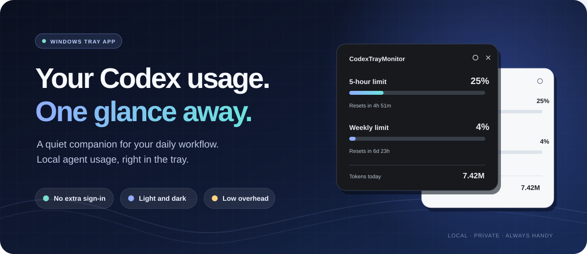
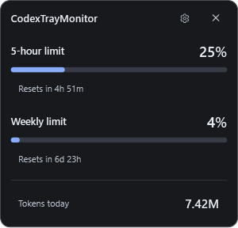
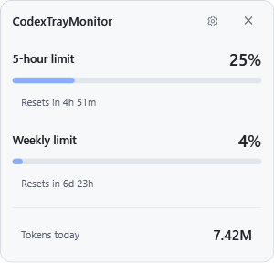

<div align="center">

# Codex Tray Monitor

**A focused Windows companion for Codex usage.**

A small Windows tray app that keeps locally observed Codex usage visible while you work with agents on this computer.

`Windows 11 x64` &nbsp; `No extra sign-in` &nbsp; `Light / Dark / System`

</div>

<p align="center">
  
</p>

---

## See it in action

| Dark theme | Light theme |
| :---: | :---: |
|  |  |

*Real app screenshots with synthetic usage data. The banner above is an illustration.*

## Why use it?

- **No separate login.** The monitor reads Codex session logs already on your computer. It never asks for your OpenAI password or API key. You need local Codex sessions for usage data to appear.
- **Low overhead by design.** It reads new log data incrementally and caches progress, so routine refreshes avoid scanning unchanged content again. Resource use still depends on the size of your session history.
- **A theme that fits.** Choose light, dark, or automatic system appearance.
- **The essentials at a glance.** See locally observed 5-hour and weekly limits, reset times, and today's token count from the notification area.
- **Local and private.** No backend, telemetry, network requests, or automatic updater. The app does not read `auth.json` or change your Codex logs.
- **Optional startup.** Turn on **Start with Windows** in Settings when you want it.

## Built for local agent work

Codex Tray Monitor stays in the Windows notification area and updates its display from session logs written by Codex on this computer. Its purpose is to keep your usage visible as you work with local agents, without opening another page or signing in to the monitor.

**Local-only scope:** It does not sync with your OpenAI account. Tokens used on another device, or in a browser session that does not write to this computer's Codex session folder, are not included in today's token count. Limit percentages and reset times are the latest observations found in local logs, not a live account-wide reading from a server.

## Install

1. Open **Releases** on this repository and download `CodexTrayMonitor-Setup.exe` from the latest release.
2. Run the installer. It installs for your Windows account, adds a Start menu shortcut, and does not require administrator rights.
3. Find the icon in the notification area, possibly under hidden icons. Left-click for usage; right-click for **Settings**, **Refresh**, and **Exit**.

The installer includes the .NET runtime, so you do not need to install .NET separately. If a release also includes the portable `CodexTrayMonitor.exe`, you can keep it in a permanent folder and run it without installation. The portable version does not create a Start menu shortcut.

The app uses the Codex folder selected in Settings, then `CODEX_HOME`, then `%USERPROFILE%\.codex`. If you have not used Codex locally, there may be no session logs to show yet. Initial builds are unsigned, so Windows may identify the publisher as unknown.

## Build from source

You need Windows 11 x64 and the .NET 10 SDK. [`global.json`](global.json) requires SDK 10.0.402 or a newer compatible .NET 10 feature band. Visual Studio with the **.NET desktop development** workload is optional; the terminal commands work without it. Restore needs the NuGet packages configured in [`NuGet.Config`](NuGet.Config), or an existing local package cache.

```powershell
dotnet build CodexTrayMonitor.slnx
dotnet test CodexTrayMonitor.slnx -c Release
dotnet publish src/CodexTrayMonitor/CodexTrayMonitor.csproj -p:PublishProfile=win-x64
```

The self-contained EXE is written to `artifacts/publish/win-x64/CodexTrayMonitor.exe`. Close any running copy from that folder before publishing again; Windows will prevent the build from replacing an EXE that is in use.

To make the installer, install [Inno Setup 6](https://jrsoftware.org/isdl.php), open [`installer/CodexTrayMonitor.iss`](installer/CodexTrayMonitor.iss), and choose **Build → Compile**. The output is `artifacts/installer/CodexTrayMonitor-Setup.exe`. Publish the installer as a GitHub Release asset, not as a source file in the repository.

## Data and privacy

The app reads `sessions/**/*.jsonl` and `archived_sessions/**/*.jsonl` under the selected Codex folder. Settings and a progress cache are stored in `%LOCALAPPDATA%\CodexTrayMonitor`. The cache stores paths, session IDs, timestamps, and numeric counters, not conversation text. The local log format can change, so readings are local estimates rather than server-confirmed account data.

Exit the app before updating or uninstalling. Uninstall the setup version from **Windows Settings → Apps**. For the portable version, disable **Start with Windows**, exit, and delete the EXE. Uninstalling leaves your Codex logs and app settings in place.

## License

This is an independent community project, not an official OpenAI application. The source is licensed under [MIT](LICENSE). H.NotifyIcon's license is in [licenses/H.NotifyIcon-2.4.1.txt](licenses/H.NotifyIcon-2.4.1.txt). Review bundled .NET runtime licenses before redistributing a self-contained build. For private vulnerability reports, see [SECURITY.md](SECURITY.md).
